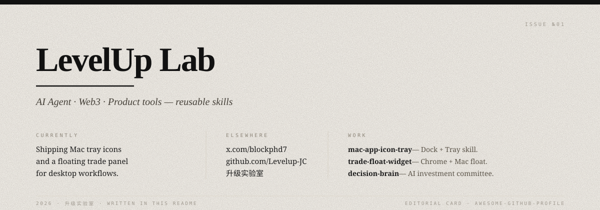

  

# LevelUp Lab

---

> *AI Agent · Web3 · Product tools — built as reusable skills.*

— **CURRENTLY**  
Shipping [mac-app-icon-tray](https://github.com/Levelup-JC/mac-app-icon-tray) and [trade-float-widget](https://github.com/Levelup-JC/trade-float-widget) for Mac desktop workflows.

— **ELSEWHERE**  
[@blockphd7](https://x.com/blockphd7) · [github.com/Levelup-JC](https://github.com/Levelup-JC)

— **WORK**
1. **[mac-app-icon-tray](https://github.com/Levelup-JC/mac-app-icon-tray)** — macOS App / Dock + menu-bar Tray skill.
2. **[trade-float-widget](https://github.com/Levelup-JC/trade-float-widget)** — Chrome summary + Mac floating trade panel.
3. **[decision-brain](https://github.com/Levelup-JC/decision-brain)** — AI investment committee · Bitget Hackathon.

---

issue №01 · 2026 · 升级实验室 · editorial card
